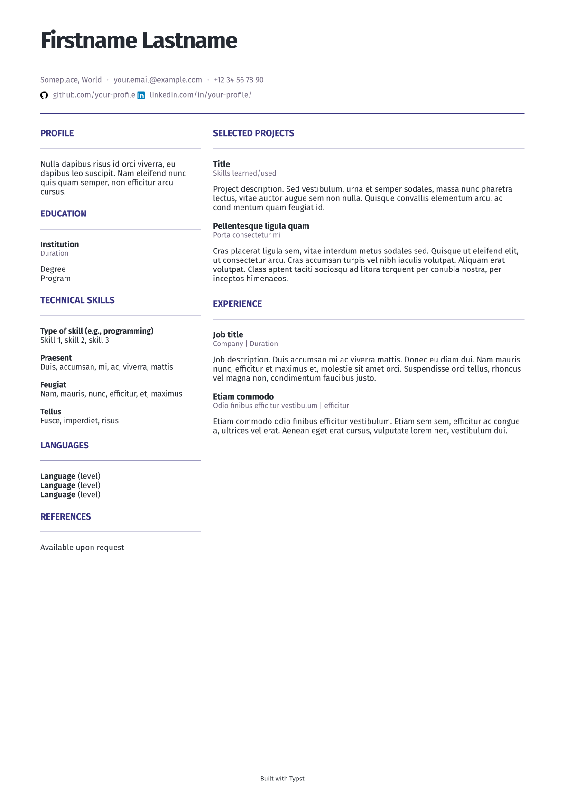

# Typst CV and cover letter template

A clean, minimal, two-column CV template built with [Typst](https://typst.app/). Also includes a cover letter template in `/coverletter`

Designed to be easy to customise, with reusable components, configurable colours, and an optional profile photo.

## Preview



## Features

- Two-column A4 layout
- Reusable components for sections, entries, and skills
- Configurable accent and secondary colours
- Optional profile photo
- Support for project links and social profiles
- Fira Sans typography

## Requirements

- [Typst](https://typst.app/) installed locally
- Fira Sans installed

On Arch Linux:

```bash
sudo pacman -S typst ttf-fira-sans
```

## Usage

Clone the repository:

```bash
git clone https://github.com/your-profile/typst-cv-template.git
cd typst-cv-template
```

Compile the template:

```bash
typst compile cv.typ cv.pdf
```

For automatic recompilation while editing:

```bash
typst watch cv.typ cv.pdf
```

## Customisation

Most of the template's configuration is defined near the beginning of `cv.typ`.

### Personal information

Update the name, location, contact details, and social links in the header.

### Colours

Change the accent and muted colours to match your preferred style:

```typst
#let accent = rgb("#383481")
#let muted = rgb("#6f667e")
```

### Profile photo

To enable a profile photo, set:

```typst
#let include-photo = true
```

Update photo-path to point to your image. The photo is disabled by default.

### Content and layout

The template includes reusable functions for common CV elements:

`section(title)` – creates a section heading and divider.

`entry(title, detail, body, url: none)` – creates a project or experience entry, optionally with a link.

`skill(label, content)` – creates a labelled skills group.

Add, remove, or rearrange these components to suit your needs.

### Project structure

``` tree
.
├── assets
│   ├── GitHub_Invertocat_Black.svg
│   ├── LinkedIn_icon.svg
│   └── preview.png
├── coverletter
│   └── coverletter.typ
├── cv
│   └── cv.typ
└── README.md

```

### License

MIT License. See [LICENSE](LICENSE) for details.
